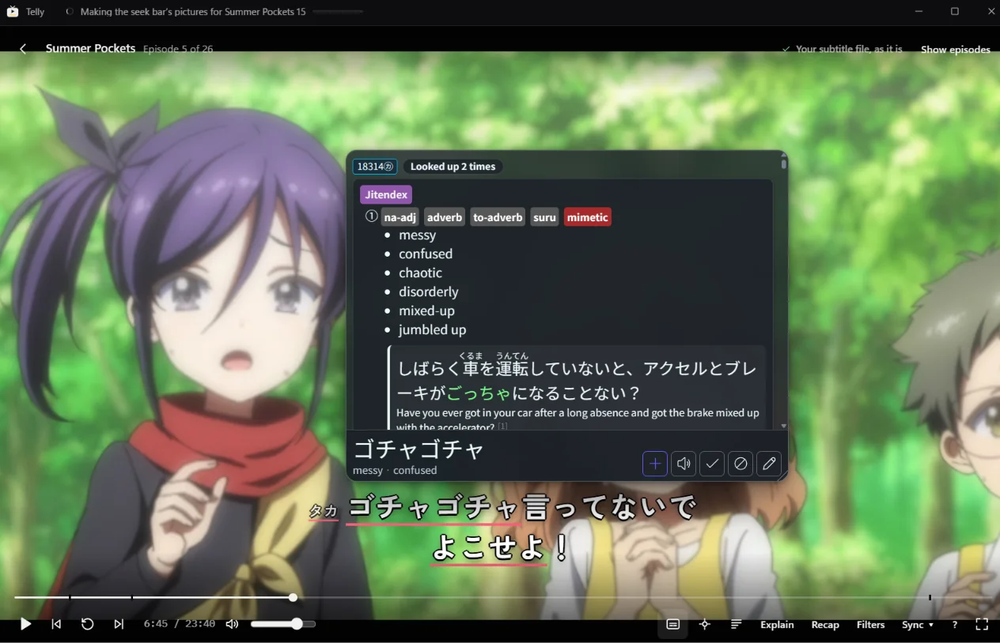
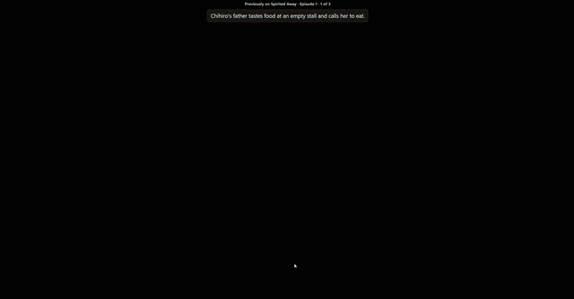
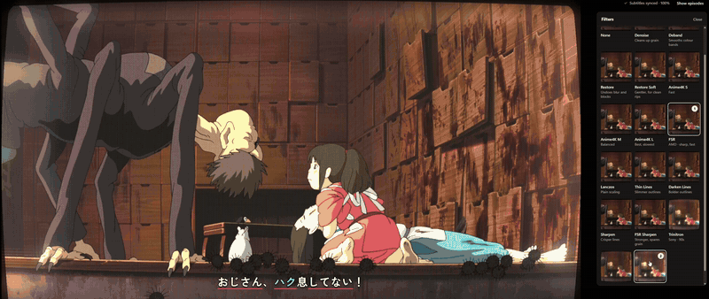
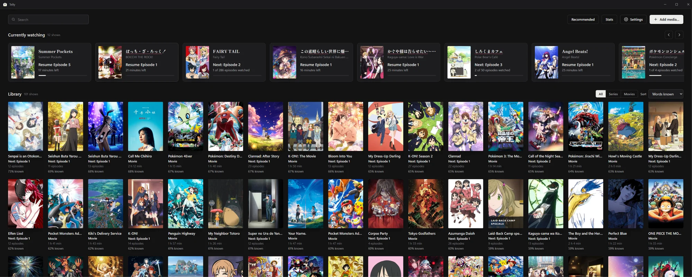
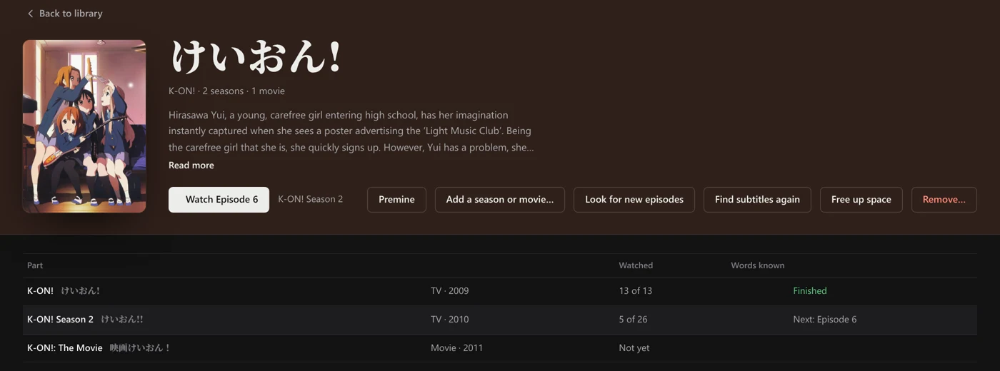
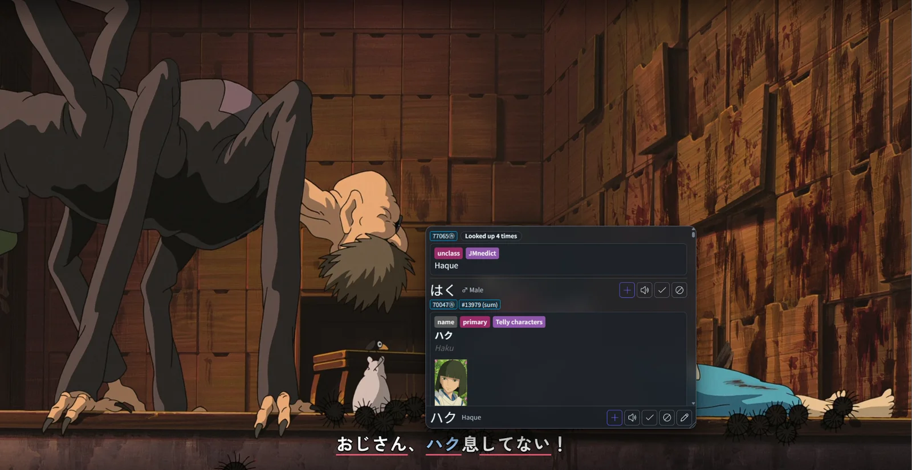
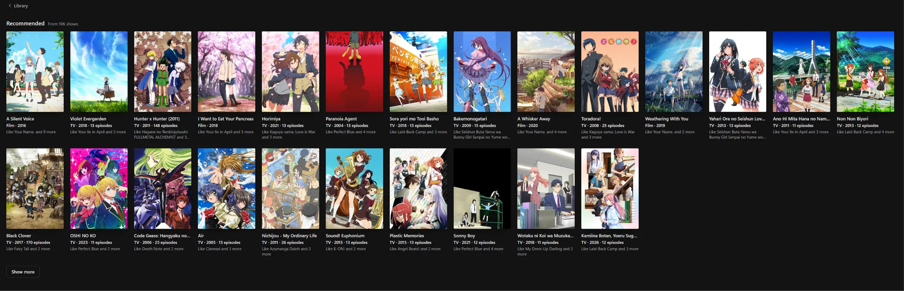
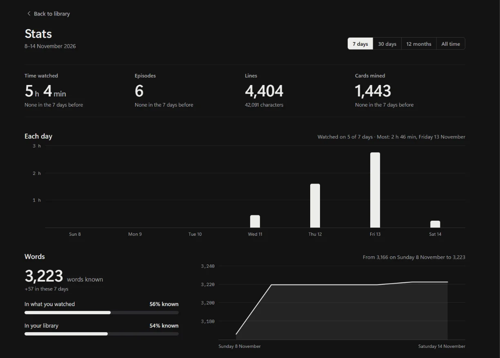

  <picture>
    <source media="(prefers-color-scheme: dark)" srcset="docs/logo-dark.svg">
    
  </picture>

<h1 align="center">Telly</h1>

  <b>Learn Japanese from the anime you already have.</b> 
  An anime player for Windows. Point it at your rips, and every word on screen is a hover away.

  

  
  
  
  
  

 

Telly finds Japanese subtitles for your rips and syncs them. Hover over a word to look it up, and mine it to Anki with the moving picture and the line's audio. Everything gets ready in the background, so you just press play.

## 📺 Previously on, like on TV

Come back to a show and Telly opens on a recap: the story so far, then the key moments from last time, cut together like a TV recap. Press **E** on any line and Claude explains it, grammar and all. The recap only uses what you've watched, so nothing ahead is spoiled.

## 🎨 Make old rips look new

Anime4K upscaling, denoising and sharpening, stacked in the order you pick and remembered for each show. Or watch it on a Trinitron.

## 📚 Pick what you're ready for

Your library shows how much of each show's vocabulary you already know, so you can sort or filter by it and start with what you can follow.

## 🗂️ Every season in one place

Each anime is listed once, its seasons and movies inside, in the order they came out, with how far you are through each.

## 📛 Know who's who

Telly builds a dictionary of the characters in what you're watching, with their portraits, and colours their names in the subtitles.

## 📱 Take it with you

Telly for Android copies the episodes you pick from your PC over your Wi-Fi and plays them anywhere. Tap a word to look it up, add it to AnkiDroid, and your PC knows where you got to when you're home. A handheld's controller does all of it too. See [Telly on your phone](docs/manual.md#-telly-on-your-phone).

## 💡 Find what to watch next

Recommendations from AniList's users, weighed across your whole library and your AniList list.

## 📊 Watch yourself get better

Time watched, cards mined and words known, over a week, a month, a year or all time.

## ✨ And more

- 🎯 **Subtitles that fit:** found on Jimaku and synced to your rip, even files timed to a TV broadcast, ad breaks and all
- 🃏 **Cards that move:** every card you mine gets an animated picture of the line, and its audio
- 💬 **English when you need it:** hold **Tab** for the rip's own English line
- 🔊 **Boost dialogue:** quiet speech comes up and loud music comes down, so you catch every word
- 🎬 **Dramas and films too:** Japanese live action is found on TMDB, with its poster and subtitles
- 📝 **Premining:** learn the next episode's new words before you watch it
- 🗣️ **Every line a word is said in,** across your whole library, ready to play
- 🪟 **A small player** that stays on top of a game, lookups and all
- ⏭️ **Skip opening and outro,** from the rip's chapters or AniSkip
- 🤖 **No subtitles anywhere?** Telly makes them with Whisper
- ⬇️ **Downloads built in:** off until you add a search site you have the right to download from; then find releases of a show and download them with Telly's own torrent client, which picks up where it was when the connection drops. Each episode joins your library as it finishes. Download only what you have the right to.
- 📈 **AniList and Tidepool** log what you watch for you

## 🆚 Why Telly?

| Without Telly | With Telly |
|---|---|
| Find subtitles, download them, line them up with your rip | Found and synced for every episode, in the background |
| Set up a dictionary popup over your video player | Hover over a word, and the episode pauses while you read |
| Take a screenshot and cut the audio for every card | Every card gets the moving picture and the line's audio |
| Try to remember what happened last time | **Previously on** |

## 🚀 Get started

1. **[Download Telly](https://github.com/bee-san/telly/releases/latest)** and run the installer.
2. Tell it where your rips are. The setup finds ffmpeg, Anki, your dictionaries and Claude Code itself, and asks only for what it can't find.
3. Press play.

📖 Everything else, from every shortcut to how subtitles are matched, is in **[the manual](docs/manual.md)**.

 

  Built on <a href="https://github.com/bee-san/hachidori">Hachidori</a>, <a href="https://jimaku.cc">Jimaku</a>, <a href="https://github.com/ikatson/rqbit">librqbit</a>, <a href="https://anilist.co">AniList</a>, <a href="https://github.com/bloc97/Anime4K">Anime4K</a>, <a href="https://github.com/Morgawr/michadame">michadame</a>, <a href="https://github.com/FireRedTeam/FireRedVAD">FireRedVAD</a> and <a href="https://claude.com/claude-code">Claude Code</a>. GPL-3.0-or-later.

