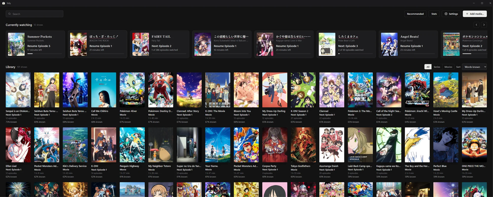
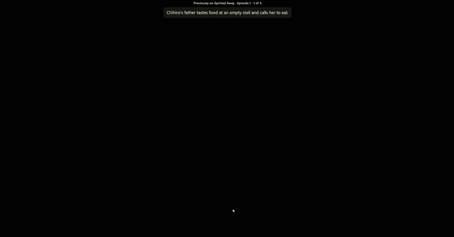
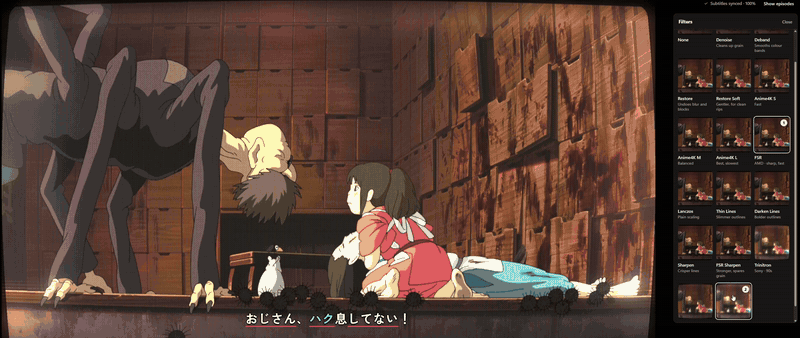
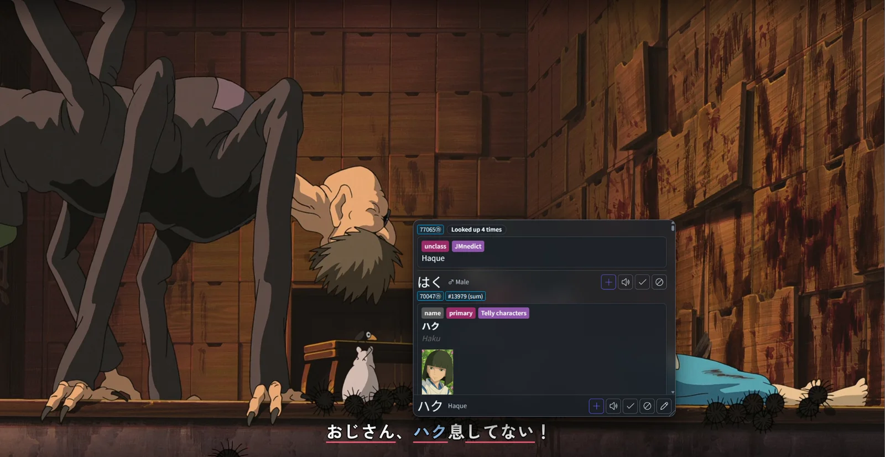
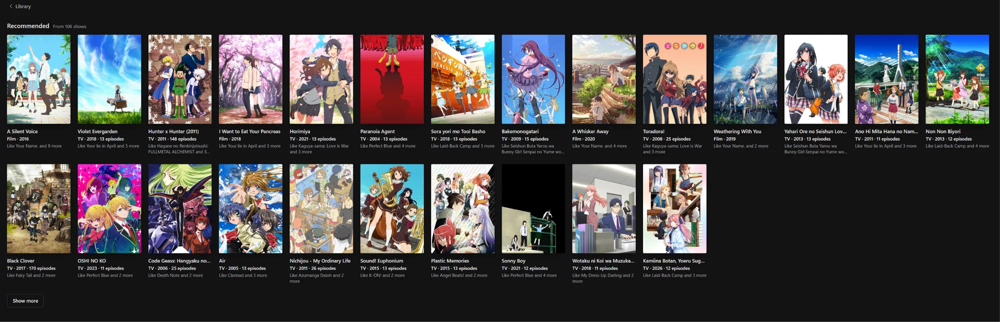
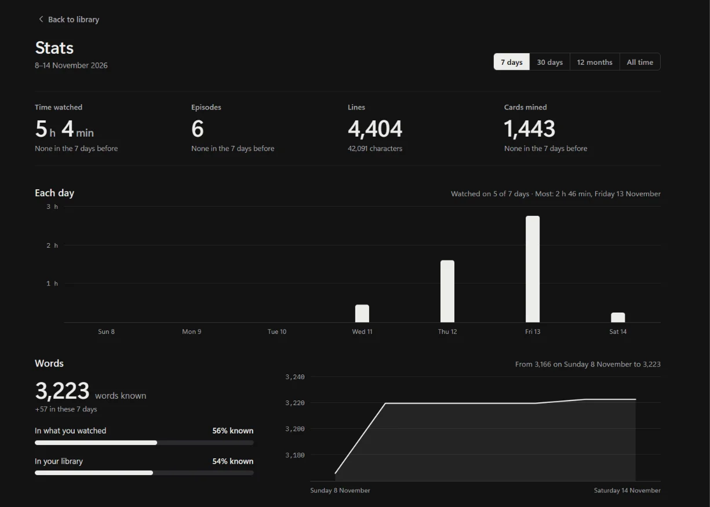

<p align="center">
  <picture>
    <source media="(prefers-color-scheme: dark)" srcset="logo-dark.svg">
    
  </picture>
</p>

<h1 align="center">The Telly manual</h1>

<p align="center">Everything Telly does, and how. <a href="../README.md">Back to the README</a> · <a href="https://github.com/bee-san/telly/releases/latest">Download</a></p>

**Contents**

- [What Telly does](#-what-telly-does)
- [Getting started](#-getting-started): installing, the first time it opens, running it from source, Hachidori in Telly
- [Keys](#%EF%B8%8F-keys)
- [Explain and Previously on](#-explain-and-previously-on) · [Filters](#-filters) · [Character names](#-character-names) · [Premining](#-premining)
- [Seasons and movies](#%EF%B8%8F-seasons-and-movies) · [Searching shows and lines](#-searching-shows-and-lines) · [Recommended](#-recommended) · [Downloading](#%EF%B8%8F-downloading) · [Stats](#-stats) · [Your AniList list](#-your-anilist-list)
- [How subtitles are matched](#-how-subtitles-are-matched) · [Machine-made subtitles](#-machine-made-subtitles) · [Getting a library ready](#-getting-a-library-ready)
- [When your rips move](#-when-your-rips-move) · [Backing up, and moving to another computer](#-backing-up-and-moving-to-another-computer) · [Where things go](#-where-things-go)
- [Developing](#-developing) · [Built on](#-built-on) · [Licence](#-licence)

## ✨ What Telly does

### 🎌 Learning Japanese

- 🎯 **[Japanese subtitles, synced to your rip](#-how-subtitles-are-matched):** it finds Japanese subtitles on [Jimaku](https://jimaku.cc) and syncs them to your rip: to the rip's own subtitles when it has any (in any language, pictures included), or to its speech, heard by [FireRedVAD](https://github.com/FireRedTeam/FireRedVAD).
- 🔍 **Hover to look up:** it shows them as lines you can look up with [Hachidori](https://github.com/bee-san/hachidori), pausing while you read and carrying on when you move back to the picture.
- 💬 **English when you need it:** it shows the rip's own English subtitles for the line while you hold **Tab**, when the rip has them as text (**?** lists every key).
- 🃏 **Cards that move:** it finishes the cards you mine with an animated AVIF of the line and its audio as Opus.
- 🧠 **[Explain and Previously on](#-explain-and-previously-on):** it explains the line on screen when you press **E**, and when you come back to a show, opens on **Previously on**: the story so far in its arcs, the episode you left, and key moments to watch again, each with a caption (both by Claude, through the Claude Code on your computer, or by gpt-oss on OpenRouter when it isn't installed).
- 📝 **[Premining](#-premining):** before you watch, it lists the words in the next episodes that you don't know yet and makes them into cards in your Hachidori card format.
- 📛 **[Character names](#-character-names):** it makes a dictionary of the characters in what you're watching, the way [characterdictionary.tokyo](https://characterdictionary.tokyo) does, adds it to Hachidori and colours their names in the subtitles.
- 🗣️ **[Every line a word is said in](#-searching-shows-and-lines):** it finds a word in every line it's said in across your library, the lines you can read first, and plays the scene around each.

### ▶️ Watching

- 🎬 **Your rips, as they are:** it plays each episode straight from the rip when WebView2 can (H.264, HEVC and AV1, 8-bit or 10-bit, in MKV or MP4), and converts what it can't (MPEG-2 DVD rips; HEVC, on a PC without Windows' HEVC Video Extensions, which Telly asks WebView2 about each time it opens; DTS and TrueHD audio, to lossless FLAC) in the background, next episode first, and first of all one you open that isn't ready (one you've watched, say, whose copy was let go). Picking up part-way through, Telly reads the picture where you left off before reading ahead and getting the seek bar's pictures. An episode that won't play, or whose picture hasn't shown a frame 3 seconds in (sound over black), offers **Convert this episode**.
- 🎧 **The right audio, and no sitting through the opening:** it plays the Japanese audio track unless you pick another for the show (**Audio ▾**, on rips with more than one), offers **Skip opening** and **Skip outro** from the rip's chapters or [AniSkip](https://aniskip.com), and marks the chapters on the seek bar. When something comes after the credits, the button says what: **Skip to the scene after the credits**, or **Skip to the preview** for the next episode's (a chapter named as one, or anything as short as one), and jumps there. When the credits run to the end, **Skip outro** opens the end card even if you paused. With **Skip endings** on in Settings, the end card opens when the ending starts, but a scene after the credits plays first; a preview doesn't, and the end card has **Watch the preview** for it. **End card** is off unless you turn it on in Settings, so the next episode starts as soon as one ends; on, the card shows what you watched (minutes, lines, characters and cards) and counts down 8 seconds to the next (the card opens either way when there's nothing next, or the next isn't ready). Near an episode's end (its last two minutes, or once the ending starts), Telly loads the start of the next out of sight, so it's playing the moment this one ends.
- 🗣️ **Dialogue you can hear:** **Boost dialogue** (**D**, or the speech bubble beside the volume) brings quiet speech up and loud music and effects down, so a whisper and a battle are nearer the same loudness, at whatever volume you watch. It stays on until you turn it off, and changes only what you hear: cards keep the rip's own sound.
- 🪟 **A small player on top:** it shrinks to a small player on top of your other windows (**I**), to watch beside a game: the picture alone, its subtitles sized to the window, and the main controls only while the pointer is over it (the rest are on their keys). Hovering a line still pauses and looks it up, and mining works as before. Drag it by the picture and size it from its corners, and it keeps the picture's shape. It opens where you left it last time (the first time, in the bottom-right corner of the screen); **I** or Esc puts the window back as it was.
- 🔤 **Subtitles where you want them:** **Subtitles ▾** in the player makes them bigger or smaller and moves them higher or lower (above subtitles burned into the picture, say), on your PC and your phone, and they stay that way for every show (the phone keeps its own, starting smaller, at 28 pixels to the PC's 36); Settings → Subtitles has both too. The menu also fixes their timing.
- 🎨 **[Filters](#-filters):** Anime4K's upscalers, FSR, Denoise, Restore and more clean up an old or small rip, and three televisions show it as on a CRT.

### 📚 Your library

- 🔎 **Shows worked out:** it works out the show on AniList and puts the episodes in order.
- 🎬 **Dramas and films too:** a show AniList doesn't know is looked for on [TMDB](https://www.themoviedb.org): a Japanese drama or film whose name is much like the folder's (半沢直樹 for `Hanzawa Naoki`, 万引き家族 for `Shoplifters`) is taken for it, with its titles, poster and what it's about, and Jimaku's subtitles for it are found by it. Anime is left to AniList. A show added before Telly asked TMDB is asked about once, when Telly next starts. **Change match…** lists TMDB's dramas and films below AniList's anime, to choose one by hand.
- 🗂️ **A library to browse:** it lists each anime once, [its seasons and movies inside](#%EF%B8%8F-seasons-and-movies), and **Filter** chooses which are listed (movies or series, the libraries they're in, how far you are with them, the share of their words you know) and in what order (when added, last watched, name, year released, words known and more); what you're watching is also in one row above that scrolls sideways, filtered the same.
- 🖼️ **A cover for everything:** what AniList doesn't know (live action, a folder of specials) gets a cover too: TMDB's poster, when it's a drama or film TMDB knows; else the poster from Wikipedia's article of that very name, else a frame from the video, taken at random when it's added, with the title drawn over it as on a poster. Every cover gets a small copy when it's got, which is what the app draws, so the Library scrolls without waiting for pictures. A film is listed as a movie, with its length.
- 📺 **A page for each show:** under a band in its cover's colour, it has what AniList (or TMDB, for a drama or film) says the show is about (its spoilers left out; **Read more** shows it all), how many episodes you've watched, and **Watch** for the next. **Premine** and **Download episodes…** sit beside it, and **⋯** has the rest: **Look for new episodes**, **Follow new episodes**, **Find subtitles again**, **Change match…**, **Move to another anime…**, **Free up space** and **Remove…**. Below, whether its subtitles and video are ready, then its episodes.
- 🔁 **Every time through:** each show or film's page in the Library shows when you first finished it and the dates you completed full rewatches.
- 💡 **[Something to watch next](#-recommended):** it recommends anime to watch next, from what AniList's users recommend to people who liked the shows in your library and on your AniList list.
- ⬇️ **[Downloads that carry on](#%EF%B8%8F-downloading):** once you add a search site, it finds releases of a show there, from Recommended or a show's page, and downloads it with its own torrent client, which picks up where it was through a dropped connection and a restart. It goes straight to its place in your library folders, and each episode joins the library as it finishes. A show you follow gets its new episodes by themselves, as they come out.
- 📈 **Logged for you:** it logs what you watch for [Tidepool](https://github.com/bee-san/tidepool), and on your [AniList list](#-your-anilist-list) once you've signed in.



## 🚀 Getting started

### 📦 Installing

Download the installer, `Telly_<version>_x64-setup.exe`, from the [latest release](https://github.com/bee-san/telly/releases/latest) and run it. It installs Telly for your Windows user.

> [!TIP]
> Run it as `Telly_<version>_x64-setup.exe /P /D=%LOCALAPPDATA%\Programs\Telly` to keep the app apart from Telly's data: without `/D` it installs to `%LOCALAPPDATA%\Telly`, the folder that also holds your library. Later installs reuse the folder the first one used.

### 🔔 When a newer Telly is out

Once a day Telly asks GitHub what the latest release is, and when that's newer than the one you have, the title bar says **Telly 0.10.3 is out**. Press it, then **Install Telly 0.10.3** in Settings → Backup and your data, under Updates: Telly downloads the release's installer (the title bar shows how far it's got), closes, and opens again as the newer one, your library as it was. **What's new** opens the release's page. Nothing is downloaded or installed until you press Install. The installer isn't signed, so Telly runs only one from this project's own releases page on GitHub, fetched over HTTPS and of the size GitHub lists for it. Nothing about you or your library is sent, and a switch beside it turns the asking off.

### 🧭 The first time it opens

Four screens set Telly up. It asks for two things, where your anime is and your keys, and finds out the rest itself:

| Screen | What happens on it |
|---|---|
| 📁 **Your anime** | you choose the folders your rips are in, or drop them on the window: a folder of anime, a folder of films, or one show's own. Telly reads them while you go on, and never moves or changes them |
| 🔑 **Your keys** | your Jimaku API key, your AniList token and your OpenRouter key. **Get a key** opens the page that has each, **Paste** takes it from the clipboard, and Telly checks it with the service it's for |
| 🔎 **The rest** | Telly looks for ffmpeg, Anki, your dictionaries and Claude Code, and lists what it found |
| 📚 **Your library** | everything Telly found in your folders, each with its AniList entry, for you to untick what you don't want. **Add all and open Telly** adds the rest |

- **The keys are needed:** **Next** waits until Jimaku and AniList have each taken theirs. OpenRouter's is needed too unless Claude Code is on this computer, which then answers Explain and Previously on: the key is marked **Optional**, and without it Whisper on this computer makes the subtitles Jimaku has nothing for.
- **Telly asks only what it can't work out.** On **The rest**, that's where ffmpeg is when it isn't on PATH or with GameSentenceMiner; which note type, fields or deck your cards use when Anki has none of the names Telly expects (kiku_typed, with Sentence, Picture, SentenceAudio and MiscInfo, in 例文マイニング); and where your dictionaries are when `Documents\dictionaries` has none. Anki Beacon and the rest can wait for Settings.
- **How a folder is read:** each folder in a folder you chose is an anime, with its seasons, movies and OVAs, and each video lying loose in it is a film, as [a library's folder is read](#%EF%B8%8F-downloading). A folder is one anime's own, and read whole, when most of the folders in it are named as an anime's parts (`Season 2`, `OVA`, `Specials`) or the videos lying in it are episodes, not films. What's in Telly already is left out. A folder of anime or of films you choose becomes one of [your libraries](#%EF%B8%8F-downloading), a Series or a Movies one, so Telly looks there again for new shows and downloads go there; one anime's own folder doesn't.
- **What Telly isn't sure of** comes first on **Your library**: a folder whose name is much like no anime's on AniList. **Choose show…** finds it there; left as it is, it's added under its own name, without an entry, and **Change match…** on its page gives it one later. Nothing is added until you press **Add all and open Telly**, and what you unticked stays out: a library's look for new shows passes it over, as it does what you remove. **Stop reading** goes on with what's been read so far.

Settings opens on an **Overview** of what isn't working and what is, found by the same checks, each with a button to the page of Settings that sets it right, and **Run setup again** opens the setup again (**Close setup** leaves it). Settings' pages are listed down its side, and **Find a setting** above them finds one by name. A library set up before there was a setup (one with shows or a Jimaku key) doesn't go through it.

### 💻 Running it from source

```bash
npm install
npm run prepare:hachidori   # once: downloads Hachidori and sets it up for Telly
npm run tauri dev
```

### 📖 Hachidori in Telly

Hachidori in Telly is ready to mine on its own, in overlay mode (lookups on hover, no first-run page):

- **Dictionaries:** it installs every Yomitan dictionary (.zip) in `Documents\dictionaries`, or the folder chosen in the setup or Settings → Lookups and names, one at a time, and again when a file changes. The word dictionaries go in first (Jitendex, JMdict, then 大辞林 and 三省堂国語辞典), so they lead the popup and the card's definition; the rest follow, smallest first. Hachidori's own Settings (Settings → Lookups and names → Open Hachidori Settings) can reorder them.
- **Pronunciation:** local recordings come first, for lookups and word audio on cards. Telly tries [Yomitan Audio Fast](https://github.com/bee-san/yomitan-audio-fast)'s standalone server on `127.0.0.1:5052`, then the Local Audio Server Anki add-on on `127.0.0.1:5050` (Yomitan Audio Fast's drop-in add-on uses that same address), then your other sources. Install and run either server with your audio collection; the add-on needs Anki open. These defaults are set even if the server isn't running yet. Reorder, disable or remove sources in Hachidori's Audio Settings; Telly sets them up only once.
- **Anki:** when a show starts playing, Hachidori's card template is set to the note type in Settings → Cards and Anki (kiku_typed) and the deck there (例文マイニング; `{show}` in its name stands for the show's title), with the tags `Telly` and the show's title (`Fairy_Tail`). Telly doesn't make the deck: only premining makes decks in Anki. The fields come from Hachidori's own mapping for Kiku, as its first-run setup makes them.

Settings → Lookups and names can link it to the Hachidori in your browser instead, so lookups use that one's dictionaries, settings and card format, through Hachidori Relay in Anki (or Telly's own relay while Anki is closed), with sharing on in the browser's Hachidori (Settings → Sharing).

## ⌨️ Keys

In the player (**?** lists them too):

| Key | | Key | |
|---|---|---|---|
| <kbd>Space</kbd> or <kbd>K</kbd> | Play or pause | <kbd>E</kbd> | Explain the line |
| <kbd>←</kbd> and <kbd>→</kbd> | Previous and next line | <kbd>P</kbd> | Show Previously on |
| <kbd>↓</kbd> | Replay the line | <kbd>M</kbd> | Add the line to the last card |
| <kbd>-</kbd> and <kbd>=</kbd> | Volume down and up | Hold <kbd>Tab</kbd> | Show the rip's English subtitles |
| <kbd>0</kbd> | Mute | <kbd>S</kbd> | Show subtitles |
| <kbd>[</kbd> and <kbd>]</kbd> | Slower and faster | <kbd>B</kbd> | Blur subtitles until hovered |
| <kbd>F</kbd> | Fullscreen | <kbd>Z</kbd> and <kbd>X</kbd> | Subtitles earlier and later |
| <kbd>I</kbd> | Small player, on top of other windows | <kbd>T</kbd> | Show transcript |
| <kbd>Esc</kbd> | Close, or leave fullscreen or the small player | <kbd>V</kbd> | Show filters |
| <kbd>?</kbd> | Show shortcuts | <kbd>D</kbd> | Boost dialogue |

## 🧠 Explain and Previously on



Both use [Claude Code](https://claude.com/claude-code), installed and signed in on this computer: Telly runs `claude -p` with no tools, the way Gromit Reader does, so it uses your own sign-in and needs no API key. It asks Haiku 5.5 unless Settings → Explain and Previously on picks another model, and answers in English or simple Japanese.

When Claude Code isn't installed and Settings has an OpenRouter API key (the one for machine-made subtitles), OpenAI's gpt-oss (`openai/gpt-oss-120b`) on [OpenRouter](https://openrouter.ai) answers instead, with the same instructions, thinking little, and the subtitles each question is about are sent to OpenRouter. It answers too when Claude Code is installed but can't (signed out, its limit reached, it won't start): the explanation says gpt-oss wrote it, as Claude Code couldn't. Its answers show as they're written, are saved the same way, and the player and Settings say gpt-oss wrote them. Settings → Explain and Previously on's model is then Claude Code's alone.

<details>
<summary>⚡ <b>How Explain answers within seconds</b></summary>

<br>

Claude Code takes 3 to 15 seconds to start, longer than Haiku takes to answer. So while the player is open Telly keeps one Claude Code started and past its first turn, and Explain asks in it: the answer starts 1 to 3 seconds after you press E and is complete within 4 (measured over 12 questions: first words after 1.1 to 3.3 s, the whole answer after 1.8 to 4.1 s, against 24 s starting Claude Code for each question with its default model). What's left is Haiku's own time to answer. Telly also starts Claude Code with its non-essential traffic off (update checks, telemetry), which saves a few seconds more.

</details>

### Explain

**Explain** (E, or Explain on a transcript line) pauses and starts with a translation, then explains the words and grammar a learner might trip on. It uses the selected line and earlier dialogue for context. The answer shows as it's written and is saved, so asking again is instant (unless you've switched between English and Japanese since; a recap, likewise, is written again in the language you've switched to). Under it:

| Button | What it gives |
|---|---|
| **Gist** | just the important part, in a sentence or two |
| **Break it down** | goes through every word, particle and ending in order, tracing each conjugated form back to its dictionary form |
| **Nuance** | says why it's put that way: its tone, politeness and culture |

Their answers are saved for the line too, so pressing one again is instant (unless you've switched between English and Japanese since). The box under them asks a follow-up question about the line, in the same warm Claude Code; each question carries the line, its explanation and the questions before, and follow-ups aren't saved.

### Previously on

**Previously on** (P, or Recap) tells the story so far: the story cut into its arcs, each with what happens in it and the episodes it spans, then **Last time** for the episode you left, then scenes to watch again, each with a caption: one for each thing in the episode you left that the story isn't done with (one for a quiet episode, up to four, fewer for a short episode or part-way through one), and one for each arc still going, up to three. They play for about a minute at most, the older ones giving way first, and the last scene always plays. The clips give each exchange time to finish before fading into the next scene.

When you come back to a show after 8 hours (Settings → Explain and Previously on), the moments play first, opening on "Previously on" and the show's title, each one's sound crossfading into the next's as the next dissolves in, as a TV recap is cut, and the episode starts after them, through a card naming it (and where it picks up); Read recap shows the text instead. Back within 3 days, it's only Last time and that episode's moments, with the rest behind Show story so far. Picking up in the middle of an episode, the recap runs up to where you stopped; in its first 5 minutes, it's the recap of the episode before. An episode's recap stops where its ending starts unless you played on past the ending, so a scene after the credits, or the next episode's preview, is told only once you've watched it (an ending skipped, or closed on, spoils nothing). Picking up a film part-way, it's the film so far, in its parts, with a scene for each thing its story isn't done with, up to six from all of it, and they all play however soon you're back.

Before a season's first episode, Previously on tells the season before: the show AniList calls its prequel, when it's in your library, told from the episodes of it you watched in Telly (the last six, carrying on from that season's own recaps), with scenes from them. A season you don't have, or didn't watch here, gets none. Every other episode's recap is of its own season alone: the second episode's is made from the first's subtitles and doesn't carry the season before on.

It's written when you leave the player, so it's ready next time (Haiku takes about 15 seconds for one episode); if it isn't, the episode starts and Telly says when the recap is ready. Each recap carries on from the one kept for the episode before, so only the episode you just left is read (up to six when there's no recap to carry on from).

## 🎨 Filters



**Filters** in the player (V) opens a panel of tiles, each showing the frame through one filter. Click filters to put them on, and they run one after another in the order you clicked them, each on the picture the one before left: with two or more, each tile says where it comes, 1, 2, 3. Click one again to take it out, or None to take them all off. The filters are drawn over the picture only, so the subtitles stay sharp, and they're remembered for each show. When an episode fills well over its own size on screen (1.5× or more) and its show has no filter picked, a note suggests Anime4K, once.

| Filter | What it does |
|---|---|
| **Denoise** | smooths out grain, as on DVD-era rips, and keeps lines sharp |
| **Deband** | smooths the bands in skies and dark gradients |
| **Restore** | undoes blur and compression blocks; **Restore Soft** does less, for a cleaner rip |
| **Anime4K** S, M and L | [Anime4K](https://github.com/bloc97/Anime4K)'s 2× upscalers, for a rip smaller than the screen. L looks best and needs the most from the graphics card |
| **FSR** | AMD's FidelityFX Super Resolution 1, an upscaler to the screen's size with its own sharpening: much lighter than Anime4K |
| **Lanczos** | scales the picture to the screen plainly |
| **Thin Lines**, **Darken Lines** | make outlines slimmer or bolder |
| **Sharpen** | crisps lines; **FSR Sharpen** is FSR's sharpening alone: stronger, and gentler on grain |
| **Trinitron**, **PVM-20M2**, **Dorm TV** | three of [michadame](https://github.com/Morgawr/michadame)'s televisions: its Halo shaders and presets, unchanged. They're made for a 4K screen: on a smaller one the scanlines fade and the picture comes out brighter. A television draws the whole screen, so it always comes last, and picking another takes its place |

Denoise, Restore, Thin Lines and Darken Lines are Anime4K's too. An upscaler works from the picture as it stands, and is passed over once the picture fills the screen: Anime4K after Anime4K doesn't double it again, and Anime4K does nothing to a rip that's already the screen's size. Lanczos shrinks a picture too, so after an upscaler that left it bigger than the screen, it does the fitting.

> [!TIP]
> For an old rip, for example: Denoise, Restore, Anime4K M, Sharpen.

The shaders and where they come from are in `src/lib/filters/shaders`.

## 📛 Character names



Telly fetches the casts of the 6 shows you watched last from AniList, with their portraits, and builds a Yomitan dictionary with [characterdictionary.tokyo](https://github.com/bee-san/Japanese_Character_Name_Dictionary)'s own builder (copied into `src-tauri/src/names`): each character's full name, its parts, kana spellings and honorifics (ナツさん, ルーシィ様…), with a card showing who they are. Names written with ・ (ナツ・ドラグニル) get each part. To keep a cast of hundreds a sensible size, main characters get every honorific, supporting characters the common ones, and background characters none.

It goes into Hachidori as **Telly characters** the way SubMiner sends its own: through Hachidori's upload requests, from Telly's Hachidori, which passes it on to the Hachidori in your browser once they're linked. A new copy replaces the last. Settings → Lookups and names shows where it is, and can leave spoilers out (the default) or in.

`cargo run --profile measure --example names_check -- <AniList id> <folder>` builds one show's dictionary on its own, to see what it holds.

## 📝 Premining

A show's page has **Premine**, and so does an anime's (its seasons and movies counted together): it says what share of the words in the show you know, and lists the fewest words you have no card for that take you to the **Target** share you choose (90% to start with), in the order they first come up, each with the first line it comes up in. **Make cards** makes a card for each.

- **Words** come from the synced subtitles, split by [Lindera](https://github.com/lindera/lindera) with IPADIC (built into Telly). Particles, auxiliaries, pronouns, words only there for the grammar (わけ, こと, ている's いる), numbers, names and the cast are left out. So is what closed captions add that nobody says: sounds in brackets （爆発音）, the speaker's name and song lyrics (♪), so a card's sentence and audio are someone speaking. Where nouns run together, the longest stretch Hachidori knows is one word (魔導士 in 魔導士たち, not 魔 and 導).
- **Hachidori** gives each word's headword, reading and rank in your frequency dictionary: Telly's own, whose engine page looks the words up and sends back only those, or, when Telly is linked to the Hachidori in your browser, that one, through the Yomitan API Hachidori Relay serves on port 19633.
- **Anki** says what you have. A note whose word field (the one your card format fills with `{expression}`) holds the word, or its reading (する for 為る), with a card you've studied, is a card you have, so the word isn't listed. Which cards count as known is chosen in Settings → Cards and Anki → Known words: a deck, the note types, the field, and whether a card need only be studied or must be mature (21 days or more from its next review, as Anki counts it). That's the share of known words at the top. A suspended card doesn't count: a word whose studied cards are all suspended still isn't listed, as you have a card for it, but it isn't known. Settings → Cards and Anki → Known words says how many notes that leaves out.
- **Most useful first:** the words that come up most in the show, then the most common anywhere, are the ones taken to reach the target.
- **Cards** are made in your Hachidori card format (the first Template in its Settings → Anki), word audio included, in a **Premined** subdeck of that deck (`例文マイニング::Premined`), so you can set how many new ones you see a day. The sentence, its furigana and the cloze come from the word's line. Telly then adds the moving picture, the line's audio and MiscInfo as it does for the cards you mine while watching, and tags them `telly::premine`.

A show's page also shows, for each episode with subtitles, the share of its words that are known, counted the same way, and the Library shows each show's. Telly keeps the shares, and a copy of the words Anki says you have, so both are there at once and with Anki closed. With Anki open they're brought up to date when Telly starts, when the Library or a show's page opens, and once a day while Telly stays open: three searches for note ids and one for the notes edited since Telly last looked (Anki counts that in whole days, so it looks a day further back), then only the notes Telly hasn't read and those edited, so a word you correct in Anki is corrected in Telly too. The show whose page is open goes first, then the shows you're watching, the latest first, then the rest.

<details>
<summary>🔬 <b>When an episode's words are worked out, and how fast</b></summary>

<br>

An episode's words are worked out when its subtitles sync, and kept. An episode whose subtitles synced while Telly's Hachidori couldn't be asked (it was starting, or installing a dictionary) gets its words when the Library or a show's page next opens, that show's episodes first, or once Hachidori can be asked. Nothing is worked out while a dictionary in your folder is still to be installed, so no episode keeps words that miss its entries.

The 10 episodes of Cyberpunk: Edgerunners season 2 (5,300 lines, 3,300 different words and runs of nouns to look up) took 26 to 32 s to work out with six dictionaries, and take a few seconds now, with the same words (runs taken in turn, Telly's Hachidori in Chromium on Linux):

- Each lookup's answer carried every dictionary's definitions of up to 32 matches, 230 MB for the 10 episodes, where Telly reads only the headword, reading and frequencies of the first. The engine page now sends only those (0.6 MB), and has 16 lookups going at once: 6 to 8.5 s.
- The engine is asked for its best 2 matches, not 32, so it reads the definitions of 2 (asked for its best match alone, the 10 episodes took 2.7 s; the 2 and the 1 lookup in 20 asked again haven't been timed on a quiet computer). It ranks every match from every dictionary before it keeps any, so its first is the same, unless the two rank the same (Hachidori keeps no order between matches that tie, so which comes first can depend on how many it keeps): when the two match the same length, preprocessing and score, the 32 are asked for, as for 1 lookup in 20.
- Redoing every episode's share when your known words change reads only the saved words: 0.4 s for 270 episodes.

`cargo run --profile measure --example words_check -- <data folder> <port> <dictionaries folder> <subtitle files>` times it against a copy of Telly's Hachidori open in a browser (see the example for how; `--shares` times the Library's pass).

</details>

## 🗂️ Seasons and movies

AniList keeps each season, movie and OVA of an anime as an entry of its own, and so does Telly: each is a show with its own episodes, subtitles and place on your AniList list. The Library lists them together, as one anime.

- **Which belong together:** AniList says how its entries are related (sequel, prequel, parent, side story, summary, spin-off and so on). Telly follows those links out from your shows, through entries you don't have, so ten Pokémon movies are one anime though the TV series they hang off isn't in your library. It asks when Telly starts and when a show is added, and about everything again after a week.
- **The card** is named after the anime's first TV series, whether or not you have it, and has the cover of the first part you have. It says what's next and in which part, and how many seasons, movies, OVAs and specials you have. Pressing it plays what's next. An anime of one show looks and opens as it always did. One that's only movies is listed under Movies; one with a season, under Series.
- **Currently watching** has an anime while a part of it is being watched, and between seasons: when you've finished one and the one AniList calls its sequel waits. That sequel is then what the card plays, not an OVA or recap movie that came out between. The anime is in the Library below all the same, sorted and counted with the rest.
- **Recently added**, under Currently watching, is a row of the anime you added in the last 30 days (a new season added counts), the newest first, up to 20. It's there only while there's something in it; the Library below has them all the same.
- **Filter**, at the Library's head, chooses which anime the Library lists and in what order, and Telly keeps what you chose. The number on it is how many of its filters are leaving something out, and the Library's count then says how many of your shows are listed (`17 of 25 shows`). What it leaves out is left out of Currently watching and Recently added too; their own order stays.
  - **Sort by:** when it was added, when you last watched it, its name, the year it came out, the share of its words you know, how many episodes it has, how much of it you've watched or how many cards you've made from it, each either way round (**Newest** or **Oldest**, **Most** or **Least**). An anime with nothing to go by (never watched, no year, no words counted yet) comes last either way round.
  - **Show:** all, series or movies.
  - **Libraries:** untick one of [your libraries](#%EF%B8%8F-downloading) to leave its shows out, or **Not in a library** for the shows kept outside them all. An anime stays while a part of it is in a library that's ticked. They're there once your shows are in more than one.
  - **Status:** not started, watching (a part of it finished or under way) or finished (every part).
  - **Words known:** only the anime you know at least 60, 70 or 80% of the words of. One with no words counted yet is left out.
  - **Only what's ready to play** leaves out an anime whose next episode is still being got ready.
  - **Clear filters** lists everything again, in the order you chose.
- **What plays next:** after a season's last episode, the next to play is the first episode of the show AniList calls its sequel, when you have it, and it starts (or the end card counts down to it) as any next episode does: Overlord's episode 13 leads to Overlord II. Films and specials between that you don't have are passed over; a season you don't have ends it. Recap movies and side stories aren't sequels, so they wait on the anime's page.
- **Its page** (press its name) opens on a band in its first part's cover colour, with what AniList says that part is about (**Read more** shows it all). Below, it lists the parts in the order they came out, each with how much you've watched and the share of its words you know. A part opens its own page of episodes. **Look for new episodes**, **Find subtitles again**, **Free up space** and **Remove…** there work on every part.
- **Premine**, on its page, [premines](#-premining) the whole anime: every season and movie you have is counted as one, so the target is a share of all its words, and a word said in three seasons is one card, with the line it first comes up in.
- **Specials AniList doesn't know** (a `Season 00` folder) join the anime whose folders theirs sits beside.
- **Adding a whole anime:** pick the folder that holds it all, and **Add media…** lists its parts, each against its AniList entry, and adds them together. Untick a part to leave it out. **Change…** on a part chooses another show for it (the anime's own seasons, movies and OVAs come first) or changes its files; **Choose another anime** matches every part again; **Add whole folder as one show** adds it as before.
  - **Seasons:** folders whose episode numbers start again are a part each, matched along AniList's sequels from the first season. Folders that carry on from each other (discs, or a long series kept in season folders) are one show. A folder with more episodes than its entry is split when the entries after it make up the rest exactly: 22 episodes of a third season are its 12 and the 10 of its Part 2, each numbered from 1.
  - **Movies:** each file in a folder of movies is a part, placed by the number in its name (`Movie 2`), else its title, else the order they came out. A movie may run past two hours. A file an hour or longer lying loose beside the season folders is a movie too, whatever it's called (`Jujutsu Kaisen 0.mkv`).
  - **OVAs and specials:** a folder of OVAs is one part, and so are the OVA files lying loose beside the seasons (the specials likewise). It goes to the anime's entry of that kind with as many episodes; three OVA series in one folder are split between their entries.
  - **A recap numbered between two episodes** (`Show - 12.5.mkv`) is left out, as an extra is, so the episodes after it keep their own numbers; press it in **Add media…** to add it back. Of two uploads of one episode in a folder (`05` and `05v2`), the later is the episode.
  - **What can't be placed** is listed as not matched, and added under the anime without an entry: better none than the wrong one.
  - A part whose folder holds other parts' rips too (one of several movies, a loose OVA, half a season folder) isn't looked in for new episodes.
  - A folder that turns up in a show's folder later with episode numbers that start again (a `Season 02` beside the `Season 01` the show's episodes are in) is another season, so **Look for new episodes** adds none of it to the show. One that carries on from the show's last episode is more of it.
- **Move to another anime…**, on a show's page, lists it under another anime in your library, or on its own, and your choice is kept. **Put back where AniList has it** undoes it.

## 🔎 Searching shows and lines

The search is in the middle of the title bar, on every page; <kbd>Ctrl</kbd>+<kbd>K</kbd> goes to it. As you type, a list under it shows three kinds of result:

- **In your library:** the shows it names, by Japanese title, English title or romaji. Telly uses AniList's titles and can also work out a reading from the Japanese title.
- **Lines:** the lines that say it, the best of a few shows, and how many there are in all.
- **Download:** the anime AniList finds that aren't in your library. **Download…** opens your search site's search for one, once [downloading is on](#%EF%B8%8F-downloading).

<kbd>↑</kbd> and <kbd>↓</kbd> choose a result and <kbd>Enter</kbd> opens it; <kbd>Tab</kbd> goes to the next kind. <kbd>Enter</kbd> with none chosen, or **Show all results**, opens a page with every result, and **Library**, **Lines** and **AniList** at its top show one kind. <kbd>Esc</kbd> empties the search.

Search for Japanese words in Japanese or romaji. Type `gakko` for 学校 or `ramen` for ラーメン. Lines are listed under their shows, each with its picture and episode. Press one to play its scene (the line with the one before and after it), or **Watch from here** to open the player there.

- **A word** finds every form of itself. `taberu`, 食べる, たべる and 食べた all find 食べた, 食べて and 食べられる, and the whole form is marked. Kana find it in either script, so だめ finds ダメ. It goes by the words premining saves for each episode. A name finds itself with an honorific after it too (フリーレン finds フリーレン様), which Telly's character dictionary makes one word.
- **Anything else** (a phrase, a name no episode has as a word) is looked for in the lines' text. So is a word premining leaves out (俺, 二人, ありがとう), where it's written outside the words it saved, and so are the lines of episodes whose words aren't saved yet, listed after the rest. A single kana isn't: it's in nearly every line.
- **The lines you can read first** lead: those that are said (not sung, not a caption's note), then those with the fewest other words you don't know. A show lists up to 100 of its lines, with how many it has.
- The lines are kept in `telly-lines.sqlite`, made from the files in `subtitles` when they sync and in a pass as Telly starts (about three minutes for 2,700 episodes the first time).

<details>
<summary>🔬 <b>How fast it is</b></summary>

<br>

On 850,000 lines in 2,700 episodes (made up, a tenth of them without their words saved), a word said in 42,000 lines took 0.27 s to answer, and 0.95 s to be listed on the page. Before the 100 a show, the same word sent 7.6 MB in 0.77 s, and a single kana 64 MB in 6.3 s.

</details>

## 💡 Recommended



**Recommended**, in the library's toolbar, lists anime to watch next. It goes on the shows in your library and needs no sign-in; once you've [signed in to AniList](#-your-anilist-list), it goes on the anime on your list there too. On AniList, people pair shows ("liked this, try that") and vote each pair up or down; Telly asks for the 25 most voted pairs of every show AniList knows, 50 shows to a request. It asks when Telly starts and when a show is added, about the shows it hasn't asked about that week, so the page opens with its answers.

- **Adding up:** each show has a say on a pick, from the pick's share of that show's votes (its square root, so a quarter of the votes counts half as much as all of them). A little-known show's favourite counts as much as a famous show's, and a pick liked from many of your shows still beats one show's favourite. A show with only a handful of votes has a smaller say, as its share is worked out as if it had 50 more. Votes for the rest of the show's own series (its sequel, say) aren't counted.
- **Spread out:** so one show's recommendations don't fill the page, each pick that the same show says most for counts three quarters as much as the one before it: its fourth counts under half, and the favourites of your other shows come between.
- **How much you've watched:** a show watched to the end counts 2; one you're watching, 1 to 2, by how much of it you've seen; one not started, 0.5, as having it only says you're curious; and one left part-way, with nothing of it watched for 30 days, 0.25.
- **Your AniList list:** signed in, each anime on your list (but those you only plan to watch) counts as the list says. One you've scored counts 2 at your average score, and 1 more or less for each 10 points above or below it, from -2 to 4: with your average at 7.5/10, a 9 counts 3.5, and a 5 counts -0.5, against its picks. Without a score, one completed counts 2, one you're watching 1 to 2 by how far you are, and one paused 0.25. One you dropped counts -1. A show in your library and on your list counts as the list says.
- **Tastes change:** what you watched in the last year counts whole, and after that half as much for every two more years, down to a quarter: a show you finished five years ago counts a quarter of one you finished this month. For one on your list it's when you finished it (for one you're watching, when you last changed it), or when you last watched it in Telly if that's later.
- **Against:** a pick that your dropped and low-scored shows say more against than the rest say for is left out, and a show that says against a pick isn't among those it's recommended from.
- **Series:** a show's seasons, films and side stories (AniList's relations, followed through entries you don't have, as [the Library groups them](#%EF%B8%8F-seasons-and-movies)) have one say between them, the biggest any of them gives. Ten films, each of a TV series you don't have, are one series, not three.
- **More of what you have:** the seasons and movies you don't have of an anime you do are picks too, marked **More of** it. Each counts as that anime's own favourite, with the whole say of the part you liked most, however long ago you watched it (wanting to know how a story goes on doesn't fade as tastes do): the next season of something you scored high sits near the top, and an anime you dropped offers nothing. Of several, the earliest out has that say, the next half of it, the third a third, so what comes next leads and thirty films of one anime don't fill the page. Recap films, specials, OVAs and shorts aren't picked, and nor is anything of an anime with a show that holds more episodes than its AniList entry has (seasons added as one show): what looks missing may be in it.
- **The page** opens on one pick over its wide picture, with **Download…** and **More about it**, then rows that scroll sideways, as Currently watching does:
  - **Suggested for you**, the picks above (the first 20; **Show all** lists every one), and **More of your anime**, its seasons and movies you don't have.
  - **Because you watched…**, the two anime you watched last (but one you dropped or scored low on your AniList list): what AniList's users recommend to people who liked them, most voted first.
  - **Top 10 series this week** and **Top 10 movies this week**, what's trending on AniList now. One you have says **In your library** and opens there.
  - **Popular this season**, **Just finished** (every episode out), **Hidden gems** (well rated, little known), **Short series** (13 episodes or fewer) and **Best rated of all time**.
  - A row for each genre, the most popular of it on AniList: the three you watch most (by the episodes you've watched of each show's genres) come among the rows above, and the rest at the end.
  - Every row but the top tens leaves out what you have, what's on your AniList list or hidden, and sequels, which aren't somewhere to start. Nothing that isn't out yet is listed. Telly asks AniList for these rows once a day, when it starts or the page opens.
  - **Show all**, or the row's name, on the top tens, the AniList rows and the genres lists the whole of it, as AniList has it now, 50 at a time (**Show more** for the next): all of Popular this season, say, sequels and the ones you have included (those say **In your library**), but not those you said **Seen it…** or **Not for me** of. **Show fewer** goes back to the rows, where you were.
- **Search AniList**, at the top, finds any other anime (so does the search in the title bar), to download one that's neither a pick nor trending. One still to come says **Not out yet** and has nothing to download.
- **A pick** opens with its synopsis, the shows it's recommended from with their votes (or where it stands among what's trending), **Open on AniList** and **Download…**, which finds it on your search site ([Downloading](#%EF%B8%8F-downloading)); **Recommended**, at the top of that page, comes back to the page as you left it: scrolled to where you were, each row where you'd slid it, and the list shown in full or the search still there. On a suggestion, **Seen it…** asks whether you liked it, for one you've seen elsewhere, and **Not for me** is for one you don't want to see. Either leaves it out from now on, and what you said counts as an anime on your AniList list would, for or against the picks like it: one you liked as one completed (2), one you didn't as one dropped (-1), and one not for you -0.5. Once you have it in the library or on your list, that says how much it counts instead. **Undo**, on the note that it's left out, brings it straight back, and **Left out of your suggestions**, at the end of the page, lists every one you've left out, with **Bring back** on each.

AniList's answers are kept for a week. A show is asked about again after that, and a show you add is asked about the next time the page opens.

## ⬇️ Downloading

Telly downloads with its own torrent client ([librqbit](https://github.com/ikatson/rqbit)), so nothing else needs installing. Downloading is off until you turn it on: Telly has no site of its own to find releases on, so you add one in Settings → Library and downloads, under **Search site** (the address of a tracker running the open-source Nyaa software). Until then, **Download…**, **Download episodes…** and **Follow new episodes** aren't shown. Download only what you have the right to. A torrent comes in small pieces from everyone sharing it, each piece checked as it arrives, so a connection that keeps dropping loses nothing: Telly carries on where it was when the connection comes back, and when Telly opens again.

- **Finding a release:** **Download…** on a pick in Recommended (a suggestion, one that's trending, or one its search found) or on an anime the title bar's search found and **Download episodes…** on a show's page open your search site's search, already searching for that show. The releases most people are sharing come first (they download fastest and steadiest); **Newest first** and **Biggest first** order it otherwise (a release of every episode in one is usually the biggest), **English-translated**, **Raw** and **Trusted uploaders only** narrow it down, and a title opens its page on the search site.
- **Every episode, one torrent each:** many anime are on a search site only as a release for each episode, with no one release of the whole season. For an anime from Recommended or the title bar's search, Telly also reads the first 8 pages of what the search site finds and puts together one release for each episode out so far, all from one group at one resolution and named alike (`[Group] Sousou no Frieren - 01 (1080p)`, `- 02`, …), and offers it above the list: **Download all 28** starts them all, into the same place. A release of a few episodes in a row from that group (`- 001-002`) stands for each of them. When the set has gaps, Telly searches again for that group's releases alone, which finds a long show's older episodes that fewer people share. Of the sets it could make, the one with every episode comes first, then the one named most like the anime (so a search for the first season doesn't get `2nd Season`), then the one most people share; of two uploads of an episode, the newer (a v2) is taken while anyone shares it. AniList says which numbers are the anime's episodes: a later season counts as many on from the seasons before it as some groups number it (`[Group] Jujutsu Kaisen - 25` is the 2nd Season's first), so the first season's name is searched for too, and a release whose name says another season (`S2`, `3rd Season`) isn't taken for this one. When no group has every episode, it says which it found no release of, in runs (`episodes 1–60, 69 and 77`). While Telly is still reading those pages, a moving bar stands where the set will go and the list below is greyed out, so you know to wait for it before picking one episode's release. The list below still has every release, a whole-season one included.
- **Which show it is:** from a pick in Recommended, the title bar's search or a show's page, Telly knows. A release found another way (**Download…** in Processing, or another search on the page) asks first: the anime its name finds on AniList, **Choose another show** when that's not it, the library it goes in and the folder.
- **Libraries:** Settings → Library and downloads lists yours, each a name, a kind (series or movies) and its folders; with several folders, one takes downloads. **Add library…**, **Edit…** and **Remove** change them, and nothing on disk moves. Taking a folder out of your libraries (removing its library, or the folder from it) takes its shows out of Telly, as **Remove…** on each show's page would; Telly says how many and asks first. The Library lists every show together, whatever folder it's in, and its **Filter** can leave a library's shows out. Until you change them, there's a Series and a Movies library, in the folders most of your anime's folders and most of your films' are in already; Telly makes them the first time it needs them, and reads them as it reads any library.
- **What's in a library's folders is added:** Telly reads each library's folders and adds what isn't in Telly yet, in the background, and [gets it ready](#-getting-a-library-ready) like any other show. It reads a library when you add it (or add a folder to it), looks again every 10 minutes, after its look for new episodes, and looks at once when you press **Look for new shows** beside the library, which says **Looking for new shows…** until it's read.
  - **Each folder in it is an anime,** added as [**Add media…**](#%EF%B8%8F-seasons-and-movies) adds one when you change nothing: its seasons, movies and OVAs, each against its AniList entry.
  - **A season, movie or OVA that turns up later** in the folder of an anime you have is added as a part of that anime: a `Season 03` put beside the two in Telly. More episodes of a season you have are that show's own to add, when it looks for new episodes.
  - **In a movies library, each video lying loose in it is a film.** So is a folder's one video that runs past two hours.
  - **Nobody checks these,** so a folder is only taken for the anime AniList finds when their names are much alike. Otherwise it's added under its own name, without an AniList entry, and **Change match…** on its page gives it one.
  - **A video is looked at once.** What isn't an episode (an extra, a second copy of an episode) is passed over from then on, so a look with nothing new only lists your folders: no video is read and AniList isn't asked. A video Telly can't read yet (still being copied there) is looked at again.
  - **What you remove stays out.** A show you remove from Telly while its rips stay in a library's folder isn't added again, and nor is what you left out of a folder in **Add media…**. Adding it with **Add media…** brings it back.
  - **A folder Telly is downloading into** joins the library as [its download](#%EF%B8%8F-downloading) says it does, and one open in **Add media…** is yours to match: a look leaves both alone.
  - **It carries on.** Closed halfway, Telly goes on with the folder when it next starts; while AniList can't be asked it waits and asks again each minute; and removing the library stops it. A folder that can't be added though AniList answers is passed by, so the folders after it aren't kept waiting, and tried again at the next look.
  - **A show whose folder is gone from a library leaves Telly** at the next look, as **Remove…** on its page removes it: Stats keeps what you watched. So does a film lying loose in a movies library whose file is gone. A folder you renamed, or moved to another of your libraries' folders, is the same show: its rips are found by name and size, and it keeps everything, as [**Find its folder…**](#-when-your-rips-move) does. No show leaves while its library's folder isn't there or has nothing in it (an unplugged drive), nor when five or more shows, over half of those in the folder, are gone at once: that's a library that moved, which **Settings → Library and downloads → Moved rips** is for.
- **Where it goes:** more of a show in the library goes in the folder its rips are in. A new show goes to its place in a library you choose: in its sheet, or, for a show Telly knows, in **Into**, above the search, with the folder it would go in, when you have more than one; everything you download from the page goes there. The one picked at first is the library of its kind (a film's, or a series') with the anime's other parts in its folders, else the first of its kind.
  - **In a series library, a season** goes in `anime\Season 01` in the folder that takes downloads. The anime's folder is the one its other seasons are in, in any of the library's folders, whatever it's called (a release's own name, say); a new anime's is named as its card in the Library. The season's number is its place along AniList's sequels from the first season, as Telly reads season folders when [a whole anime is added](#%EF%B8%8F-seasons-and-movies): Overlord IV goes in `Season 04`.
  - **A spin-off or an OVA** goes in a folder of its own name in the anime's folder. So does a film, and a season whose folder is there already with another show's rips in it.
  - **In a movies library, a film** goes in `title (year)`, a folder each, also when it belongs to an anime with seasons: the Library lists it under the anime all the same.
  - **A release of several seasons or movies** goes in the anime's folder as it is.
  - The files keep the names they were released with, and nothing already on disk is moved or renamed. A release with a file of the same name as one already where it would go (a rip, an extra, a subtitle file) isn't downloaded: Telly says which, rather than write over it. That holds for a release started from its magnet link too, which is checked once the people sharing it say what files it has, before anything is written. Only a file one of Telly's own downloads left half there is carried on with. To make room beside a show whose folder is the anime's own (its rips a season folder down), Telly takes the folder its rips are in as that show's from then on.
  - **With no library**, or downloaded without a show, a release goes in a new folder named for it (`Sousou no Frieren 2nd Season` for `[Group] Sousou no Frieren 2nd Season - 09 [1080p]`) in the downloads folder: `Downloads\Telly` in your home folder, or the one chosen in Settings → Library and downloads.
- **Into the library:** a file that's still downloading is left out when Telly looks in a folder, so no episode is added half there. When a file finishes in a show's folder, Telly looks in the folder at once and the episode joins the show. A new show is added when its first file finishes, as the show you said it was, and the rest of it joins as it finishes. A release downloaded without a show, or one of several seasons or movies, is offered in Processing once something of it is down: **Add to library…** opens Add media on it. While one waits to be added, or a download has stopped on an error, the title bar says so, and pressing it opens Processing.
- **New episodes, by themselves:** **Follow new episodes**, on the page of a show that hasn't all its episodes yet, has Telly look on your search site for the episodes after your latest and download each into the show's folder, where it joins the show, gets its subtitles and is ready to play. It takes the release your latest episode is from (the last one Telly downloaded for the show, or your latest rip's file name): the same group, title and tags (resolution, codec), so after `[Group] Sousou no Frieren - 05 (1080p)` comes that group's 1080p episode 6. Telly looks when you turn it on, a couple of minutes after it opens and every hour after that, but not while a game is running, and catches up on every episode that came out while it was closed. A rip without its episode number in its name gives Telly nothing to go by, and it downloads nothing rather than guess; an episode's title in the name (`- 05 - The Return`) is each episode's own, and doesn't count. An episode whose download is gone without the episode (removed in Processing, or nobody ever answered for it) is looked for again at the next look. Nobody is watching when these download, and anyone can upload under a group's name, so Telly takes a release only when it's like the episodes before it: from an uploader the search site trusts when theirs were, about the size of an episode (a third of it to three times), and with someone sharing it. Of two uploads named alike, the first one up is taken, and a v2 over both. **Stop following** ends it.
- **Processing** opens from the title bar, where Telly says what it's doing: press that while only downloads run, or **Open Processing** in its list while Telly is getting episodes ready too. It shows each download's progress, speed and time left, beside what Telly is getting ready. **Pause**, **Carry on** and **Remove** are on each; removing a download leaves what it got where it is. While downloads run and Telly has nothing else to do, the title bar shows how they're going, and clicking it opens Processing.
- **Sharing back:** a finished download is shared with others while Telly is open, as torrents are, until it's removed in Processing, unless Settings says not to share finished downloads (below). The first time Telly downloads, Windows may ask whether it can use the network: allowing it lets the people sharing a release connect to Telly too, which makes downloads faster. Telly also asks your router to let them through (UPnP), until you turn that off.
- **Yours to say:** Settings → Library and downloads has what the torrent client may do.
  - **Download speed** and **upload speed**, at most, in KB a second. There's no limit until you set one, and a limit holds from the moment it's set.
  - **Keep sharing a download once it's finished**, on until you turn it off. Off, each download stops being shared the moment it finishes. One still downloading shares what it has with the others getting it, as torrents do, which the upload limit slows.
  - **Ask the router to let others connect to Telly**, on until you turn it off: with UPnP, your router opens a port to Telly. Off, Telly only connects out, and nothing is asked of the router.
  - **Download only through** one network connection, for a VPN. Telly downloads and shares only while that connection is up: within a second of it dropping, its torrent client stops altogether (nothing downloads, nothing is shared, and nobody is asked who has what), and it starts again when the connection is back. Processing says what it's waiting for. Telly can't tie the client to the connection itself on Windows, so this is for a VPN that carries all your traffic while it's on.
  - **Keep free on the drive**, 1 GB until you change it. Telly doesn't start a download there isn't room for, counting what's there of it already and what your other downloads on that drive still need, and says how much is missing. A release started from its magnet link alone, whose size isn't known yet, isn't checked.
- **Picking up again:** Telly keeps the list of downloads in `torrents` ([Where things go](#-where-things-go)). The client writes down how far a download got only every 16 MB, so when Telly opens, each download that wasn't finished checks what's already on disk (a few seconds an episode) and carries on from there.

Telly fetches a release's `.torrent` file from the search site, asking again when the connection drops; when it can't, it starts from the magnet link, and Processing says it's asking the people sharing it for its list of files until they answer.

## 📊 Stats



**Stats**, in the library's toolbar, adds up what you've watched, mined and learnt over the last 7 days, 30 days, 12 months or all time. It's all from what Telly already keeps.

- **Time watched, lines and characters** come from the log Tidepool reads (`telly-log.sqlite`), by the day each sitting ended. **Episodes** are those played to their end, the first time or again. Over 7 or 30 days, each figure is compared with the same length of time before.
- **Cards mined** are the cards Telly finished with their picture and audio, premined ones too, by the day it finished them.
- **Each day** (or **Each month**) charts the time watched. Hover over a bar for that day's episodes and cards.
- **Words** are the words you know, as Settings → Cards and Anki → Known words counts them, charted by the day each word's first card was made in Anki. That's when its card was made, not when you learnt it. **In what you watched** is the share of the period's episodes' words that you know now, and **In your library** the same for every episode.
- **Finished** has the shows finished or fully rewatched in the period. Press one for its own page: its time, lines and cards, each episode's cards and share of known words, the days you watched it (a row for each time through), and the words you mined from it, each in its line. A card's word shows once you've studied the card; until then, its line shows alone.
- **A show you remove** from the library stays in Stats as it was: its time, episodes, lines, cards and share of known words, and its place among the shows finished, with its cover. Its own page goes with it.

## 📋 Your AniList list

In **Settings → Keys and accounts**, **Get a token** opens AniList, which shows an access token once you approve Telly. Paste it and press **Sign in**. From then on, each episode you watch raises that anime's progress on your list, and its last episode marks it completed.

- Only episodes watched after signing in count. Progress only goes up: rewatching an earlier episode, or marking one unwatched, changes nothing.
- Watching a show your list has as completed (finished in Telly or anywhere) is a rewatch: it's marked **rewatching** at the episode you're on, goes up as you watch, and is completed again at its last episode, its rewatch count one more. An episode counts when it's played to its end again; rewatching only the last episode starts no rewatch, and nor does marking episodes watched by hand.
- A show added as one folder holding several seasons: the first season folder goes to the show's own entry, and a later one to the entry AniList finds for its folder's name, numbered from 1 within that folder. When AniList isn't fairly sure which entry a folder is, or a number is past the entry's last episode, nothing is logged.
- A film is its entry's one episode, whatever number its file's name has (`Jujutsu Kaisen 0.mkv`, `Kizumonogatari 3.mkv`): watching it completes it.
- Shows AniList doesn't know aren't logged.
- If AniList can't be reached, Telly tries again every 10 minutes, and Settings says why it failed.
- **Recommended** goes on what's on your list, except what you only plan to watch, and leaves it out of its picks ([Recommended](#-recommended) says how each counts). A copy of the list, with each anime's status and your score, is kept, fetched again when Telly starts, when you sign in and after Telly updates it.

## 🎯 How subtitles are matched

Telly tries every file Jimaku has that could be the episode's, syncs each to the episode, and keeps the one that fits best. Jimaku has a show under its AniList entry, or a drama or film under its TMDB entry; a show with neither is looked for by its name, among Jimaku's live action as well as its anime.

- **Your own subtitles:** a Japanese subtitle file beside the rip and named after it (`Episode 01.ja.srt`, `Episode 01.srt`) is used as it is, with nothing of the rip read and no sync to move it: you put it there. Every show's episodes get theirs before any rip is read. Of several, the one re-timed with alass (`.alass.srt`) is taken, then one marked Japanese (`.ja.srt`, `.jpn.srt`), then one named just as the rip, and a machine-made one (`.ai.srt`) last; the episode's page can switch to another. A Japanese track inside the rip comes first among the rest: when it's in sync already (a sync would move it less than half a second), Telly keeps it as it is and doesn't ask Jimaku. Otherwise it's synced along with Jimaku's files.
- **What files are matched to:** the rip's own subtitles when it has any, in any language. Picture subtitles (PGS, as on most Blu-ray rips) are read from the container's packets: no OCR is needed, only when each subtitle shows. They're timed to this very video, so they place a file far more precisely than the speech does, and in a few seconds. Lines showing at once (a song's karaoke) count once. A rip without subtitles is matched to its speech, heard by FireRedVAD (FireRedTeam's detector, which finds 96% of speech where WebRTC's finds 36%, without music fooling it).

<details>
<summary>🔬 <b>How Telly judges a fit, picks a file and places it</b></summary>

<br>

- **How sure a fit is:** by how much of the timing the file's lines cover, against the same lines moved 20 seconds to 5 minutes away, and by how often they start where the timing's lines start (within 0.3 s), against the same moved 23 seconds to 3¼ minutes away. Where the timing has lines most of the time, in long stretches of talk, a file moved a minute covers nearly as much, so coverage says little; where the lines start still says where the file belongs. So a file fits with one shift when its line starts stand 6.5 spreads above chance, and each quarter of it above chance on its own: the lines of a TV broadcast's file between two ad breaks stand far above chance at their shift, but that shift doesn't fit the rest. Line starts tell a file's speed (PAL) too, where coverage can't.
- **Which number:** a show added as one folder holding several seasons gets its files looked for under Telly's number, the number in the file's name, and that number after the season folders before it, since Jimaku's packs often number a whole run from 1. A season folder's own AniList entry is looked up on Jimaku too. What fits teaches the folder its numbering, and when nothing expected fits, every file is screened and the best few synced in full: a release whose order differs (Judas's Fairy Tail 2014 runs in another order than Netflix's from its 48th episode) still finds each episode's file.
- **Which file:** one synced in one piece beats one that fits only cut into pieces (below); otherwise one that fits beats one that doesn't; then clean Japanese text (not furigana or English set as lines); then a file made for this very release (the same release tag); then the smaller shift; then the tighter fit. A Japanese track inside the rip counts as made for it, and as an exact fit when the rip is matched to that track. When nothing fits, Telly keeps nothing rather than the wrong episode's lines.
- **Files timed to a TV broadcast:** a recording of the broadcast has the ads in it, so its subtitles are a minute or more out after each break and don't fit with one shift. When no file syncs with one shift, Telly cuts each file where alass cuts it, but only where the broadcast's lines pause for 20 seconds or more (an ad break, the opening): elsewhere alass moves an episode's last scene onto the closing song, whose sung lines, thick and fast, agree with anything. Each piece goes where its lines start with the timing's. Coverage can't judge pieces, since another episode's file cut up covers the timing as well as one that belongs, but line starts can: the pieces are kept only if, together, their lines start with the timing's far more often than when moved 23 seconds to 3¼ minutes away (6.5 spreads above chance). A piece of under 10 lines, or no better than chance, follows its neighbour, so a short recap or cold open that can't be placed is left out rather than shown at the wrong time.

</details>

<details>
<summary>📏 <b>Measured on Fairy Tail and Cyberpunk: Edgerunners</b></summary>

<br>

Measured on Fairy Tail's 286 Judas Blu-ray episodes: every one of the 277 TV episodes synced (files that belong stood 6.3 to 17 spreads above chance, files that don't at most 5.4), Judas-timed files chosen where they exist (1 to 40), Netflix's elsewhere, and the 9 OVAs, for which Jimaku has nothing, left without. Synced by speech instead, the same files came within 0.15 s.

Files timed to the TV broadcast, measured on episodes 1 to 40: the 23 that don't fit with one shift came apart into 2 or 3 pieces (episode 3's at −5, −75 and −165 s: a 70-second ad break, then a 90-second one), each piece's lines a median of 0.6 s or less from where the Judas files have them, and 81% of lines within a second (77 to 89% for the TV files that fit with one shift). Against the rip's English subtitles they stood 8.1 to 20 spreads above chance; 508 other episodes' files (TV and Netflix-timed, 1, 2, 5 and 11 episodes away) stood at most 4.4, and none was kept. Matched to the speech instead, 18 of the 23 were kept (one with one shift), and none of the other episodes' files (at most 3.6).

Measured on Cyberpunk: Edgerunners season 2 (10 episodes, each rip with 10 full subtitle tracks, and a Japanese file beside it in time with it): against each of the rip's tracks, the files that belong had their line starts stand 29 to 43 spreads above chance (23 to 36 against the speech); the other 9 episodes' files at most 4.7 (3.3), and none of them was kept, against the tracks (900 tries) or the speech (90). By coverage alone, the files that belong stood only 4.7 to 5.4 in episodes 4 and 7, whose subtitles show 57 and 59% of the time, and those two got none; matched to the speech, 4 of the 10 were sure and 2 got none. Now every one is kept and synced, within 0.07 s, against the rip's subtitles or its speech, and so is each thrown 3.2 s late or 40 s early, sped up or slowed down for PAL (matched to the speech, 1 of the 10 was before), with its lines split, merged or started up to 0.3 s out, or with a scene 4 s out (8 of the 10 are cut back where it moved). Timed to a broadcast with ads of 90 and 75 seconds where the talk pauses about a third and two thirds in, each came apart into its 3 pieces, every line within half a second.

`cargo run --profile measure --example sync_real -- <telly.sqlite> <jimaku folder> 1-286` runs this over a library, read-only, and says what Telly would keep for each episode.

</details>

## 🤖 Machine-made subtitles

When Jimaku has nothing for an episode (or there's no key yet), its show's page offers **Make subtitles with Whisper**. It uses the whisper.cpp Tidepool downloads for voice input, with one of whisper.cpp's multilingual models, chosen and downloaded in Settings → Subtitles: small (190 MB, the default), medium (539 MB), large v3 turbo (574 MB) or large v3 (1.1 GB). How much better the bigger ones hear Japanese hasn't been measured here. Whisper's subtitles are marked as machine-made.

With an OpenRouter API key in Settings, a model on [OpenRouter](https://openrouter.ai) makes them instead, and the button names it: MAI-Transcribe 2 (the default), ElevenLabs Scribe v2 or Whisper large v3, chosen in Settings. Each episode's Japanese audio is sent to OpenRouter in pieces of about 5 minutes, cut where the audio is quietest, because a provider gives a request 60 seconds. A 24-minute episode costs about $0.04 with MAI-Transcribe 2, $0.09 with ElevenLabs and $0.01 with Whisper (what OpenRouter charged for 90 seconds of each in November 2026). The audio goes as WAV, which all three take. On 90 seconds of one episode, MAI-Transcribe 2 and ElevenLabs heard every line and timed each within a quarter of a second of the episode's own subtitles; Whisper added lines nobody said. More than that hasn't been measured here.

With that key, Telly also asks OpenRouter by itself, without the button. An episode no subtitle file fits has its subtitles made this way. And when a file's timing fit is doubtful, four 90-second stretches of the episode are sent: if at least 12 of the lines heard, from at least 3 stretches, read like the file's lines and agree on one shift, the file is moved there (the episode's details say “matched to what MAI-Transcribe heard”, naming the model chosen); if not, the timing's own answer stands. On one episode, with whisper.cpp's small model listening, a file thrown out by 1.1, 7.3 and 42 seconds came back within 0.08 s.

## ⏳ Getting a library ready

Telly works through a library in the background: each show's next episode first, then the 10 after it, then the rest. Several episodes are worked on at once, and the title bar says which show is being got ready, or how many shows. Click it for what each worker is doing and how far it's got, and for the work waiting of each kind (video, subtitles, the seek bar's pictures, words), the next to be taken first. **Processing**, opened from the title bar, shows the same on a page of its own, with the [downloads](#%EF%B8%8F-downloading).

- **Video:** one conversion at a time. A rip that plays as it is doesn't wait behind one: a second worker reads what's in the rips nobody has looked at yet, about a second each.
- **Subtitles:** 3 episodes at once. A rip is read through once for all its subtitle tracks together, text and pictures, however many it has; a rip without any is heard in that read, to match files to its speech. Jimaku is asked by one episode at a time, and a show's files are fetched once.
- **For the player:** that one read also makes the seek bar's pictures, when the rip itself is what plays, and keeps the rip's English lines, so the player doesn't read the rip from end to end when an episode first plays. On an SSD, the subtitle tracks are read on their own first, in a fraction of a second where the pictures take seconds, and the pictures made just after, from what that read left in Windows' file cache. Telly's own copy of an episode gets its pictures when the copy is made. Episodes got ready before this are caught up in the background, next episodes first.
- **One rip at a time from each hard drive:** the rest of an episode's work (asking Jimaku, syncing its files) goes on while the next rip is read, but two rips aren't read from one hard drive at once, and the episodes that come first (each show's next) are read first. A hard drive reads two at once slower than one after the other. An SSD, which Windows tells apart, is read three rips at a time; a drive Windows can't say (a network share, some USB enclosures) is read as a hard drive.
- **While you watch:** no rip is read from end to end off the hard drive the episode playing is on until the player closes, so the picture never waits for the drive. Two things don't wait: a rip on an SSD, which reads both at once, and the subtitles of the episode playing and of the one after it, so the next episode is ready when you get to it.
- **When something's in the way, the work waits:** if Jimaku asks Telly to slow down, is down or can't be reached, the episodes waiting for subtitles stay waiting and Telly asks again when Jimaku says to (or after two minutes), rather than giving up on each in turn. If the copies folder isn't there (its drive is unplugged) or hasn't room for the next copy, conversions wait, the title bar says which, and they carry on by themselves once it's back or there's room. ffmpeg and whisper.cpp are stopped if one runs far longer than its work should take (90 minutes to read a rip, 8 hours to hear one), and they end when Telly closes.
- **While a game is running:** no episode starts converting, getting its subtitles or its seek bar's pictures until the game closes, so the game has the processor and the drive. An episode already under way is finished. The title bar says what the work is waiting for: "Waiting for Wow.exe to close". A game is a program in a Steam, Epic, GOG, Riot or Xbox games folder (`steamapps\common`, `Epic Games`, `GOG Games`, `Riot Games`, `XboxGames`) or in `World of Warcraft`, or `Wow.exe` or `WowClassic.exe` wherever it is. The launchers and services that stay running in those folders (Epic Games Launcher and Epic Online Services, Riot Client, Wallpaper Engine) aren't games. Telly looks every 10 seconds. Settings → Games turns this off, and adds other games by their program's name, which is all Telly goes by for a game Windows won't tell it the folder of (one run as administrator, say).

<details>
<summary>📏 <b>Measured on a USB hard drive and an SSD</b></summary>

<br>

Measured on a 4 TB USB hard drive (Seagate Expansion, exFAT) nothing else was reading, each run on rips that weren't in Windows' file cache:

- **A film** (Princess Mononoke: one file of 18 GB with five text subtitle tracks and one of pictures, and a Japanese subtitle file beside it): 26.8 minutes when each track was read in a pass of its own (six passes of 233 to 277 s), 4.4 minutes now (261 and 267 s). The subtitles kept are the same, byte for byte.
- **8 ordinary episodes** (four of Fullmetal Alchemist: Brotherhood and four of Sword Art Online II, 2.9 GB, 2 or 3 text tracks each): 67 and 84 s before, 60 and 62 s now. A small rip's second and third passes came from Windows' file cache, so they cost little; a film is bigger than the cache.
- **Two rips at once:** 8 episodes of one show were read at 37 and 40 MB/s one at a time, 26 and 31 MB/s two at a time, 25 and 35 MB/s four at a time. 8 episodes of four shows, which lie further apart on the drive: 38 and 48 MB/s one at a time, 23 MB/s two at a time, 21 and 23 MB/s four at a time.
- **The seek bar's pictures:** each keyframe is decoded on several cores, since keyframes are too far apart for ffmpeg's usual threads to share: 4.6 s for a 24-minute 1080p HEVC episode, where it took 17.7 s, for the same pictures. Made in the same read as the subtitle tracks, they took a 10-bit H.264 episode's read from 7 s to about 10 s (its keyframes decode on one core), and 12 Fairy Tail episodes on an SSD from 17 s to 52 s. The whole pipeline wasn't timed on the hard drive with them, as the drive was busy.
- **How many at once:** on an SSD, where nothing waits long for the drive, 24 episodes of Fairy Tail took 81 and 103 s with one worker, 54 and 59 s with two, 34 s with three, 27 and 47 s with four, 26 and 39 s with six. On the hard drive the drive is the limit whatever the number.

`cargo run --profile measure --example jobs_check -- <data folder>` runs the background work over a scratch copy of a library and says when each episode was done, and what the title bar said.

</details>

## 🚚 When your rips move

Telly knows a show's episodes by where their rips are. When the rips aren't there:

- **An unplugged drive** isn't a show that's gone: nothing of the show is got ready, given up on or forgotten until the drive is back, and the show's page says its folder isn't there.
- **A show's folder deleted from one of [your libraries](#%EF%B8%8F-downloading)' folders** is a show that's gone: it leaves Telly at the next look, within 10 minutes. One renamed or moved within your libraries is found by itself. A show that's in no library stays, its page saying its folder isn't there.
- **Find its folder…**, on the page of a show whose rips aren't where they were (the folder moved or was renamed, or the drive's letter changed), asks which folder it's in now. Telly matches each episode to a file there, by its place in the show's folder first, then by its name and size, and shows what it found ("24 of 24 episodes found", and which it didn't) before anything changes. **Use this folder** keeps everything: where you were, what you watched, the subtitles, kept explanations and recaps, the seek bar's pictures and your cards. Episodes it didn't find are left as they were, and what failed because a rip wasn't there is tried again.
- **Settings → Library and downloads → Moved rips** does the same for every show in a folder at once: everything that was in `D:\Anime` is now in `E:\Anime`. Your libraries' folders and the downloads folder that were in there move with them, a library's folder Telly hadn't read yet (its drive was away) included.
- **Look for new episodes** (and Telly's look every 10 minutes) finds a rip moved within its show's folder, into a season folder, say, by its name and size, rather than taking it for a new release of the episode.
- **A rip replaced by a new release** (the old file gone, the new one in the show's folder) takes the episode's place, by the episode number in its name: where you were stays, and the new rip is got ready from the start. A film's has no number to go by, so the one new video in a film's folder is its rip, whatever it's called.

## 📱 Telly on your phone

Telly for Android plays episodes your PC got ready, anywhere, with or without a signal. Your PC still finds subtitles, downloads and converts; the phone keeps copies of the episodes you pick.

**On the PC:** Settings → Playing → **Your phone** → *Lend episodes to Telly on your phone*. Telly listens on port 8775 on your home network while it's on (Windows asks once whether to let it) and shows a six-figure code. Forget takes back every phone paired: each pairs again with the code.

**On the phone:** **Get from PC** finds Telly on your Wi-Fi, or takes the address Settings shows, and pairs with the code once. It lists your shows; tick the episodes you want (**Pick the next 3** ticks the next three you haven't watched) and **Get**. The phone tells the PC what it plays, and each episode goes over as it is when the phone plays it, it's an MP4 and it has only the Japanese audio, with nothing converted. Otherwise the PC copies it into an MP4 in seconds with the Japanese audio alone (an MKV opened part-way through freezes on Android), converts that audio to AAC when the phone doesn't play it (Android plays no AC-3, E-AC-3 or DTS: such an episode would be silent), and converts the picture, on your graphics card, only for a phone that can't play it. A copy that stops carries on where it stopped, and the PC deletes a copy it made once the phone has it; your rips are only read. An episode the PC hasn't got ready yet is got ready first. One the PC couldn't get ready (it wouldn't convert) is copied from its rip all the same, as the phone may play what the PC can't, and when that fails too the phone says why and gets the rest.

The phone's Library has only what it got: what you're watching first, then every show with its episodes, which are on the phone, and which are being got. **Remove** deletes the phone's copy; it stays on your PC. Watched copies stay until the phone needs the room for new ones, the longest-watched going first. **Settings**, beside Get from PC, has the phone's own subtitle size and place, whether characters' names are coloured, and Settings → Playing's episode choices and Previously on's, as your PC's Settings has them; the rest it takes from your PC.

Telly for Android is on each [release](https://github.com/bee-san/telly/releases/latest) beside the Windows installer, as `Telly_<version>_android.apk`. Once a day the phone asks GitHub what the latest release is, as the PC does, and when that's newer its Library says **Telly 0.14.0 is out**. **Install Telly 0.14.0** downloads the release's APK and Android asks you to update; the first time, it asks you to let Telly install apps, then press Install again. Your phone's episodes and where you got to stay as they are.

Each time the Library opens, and with **Sync now**, the phone gives the PC where you got to, what you watched and what Claude said, and takes in what changed on the PC for its shows: every episode's subtitles (Previously on tells the story from them), your dictionaries, and the settings for Explain, Previously on and cards. Where you are in an episode is wherever you played it last. A sync also gets the next 3 episodes you haven’t watched of each show you’re part-way through on the PC, the one you watched last first, unless you untick **Get the next 3 episodes of what you’re watching** in the phone’s Library. That happens while Telly is open on the phone and it reaches your PC.

On the phone Telly has the whole screen, with Android's bars hidden (a swipe from the edge shows them for a moment), and the player turns it sideways by itself. A tap shows the controls or hides them, and they hide by themselves after 10 seconds untouched, paused too; two quick taps to the left or right go back or on 10 seconds. The phone's own buttons set the volume, so the player has only Mute, and all its controls fit across even a small phone's screen.

**With a controller** (a handheld's own, like the AYN Thor's, or one paired with the phone), nothing needs a touch. In the Library and Get from PC the D-pad or the left stick moves a yellow ring over what can be pressed, **A** presses it, **B** goes back and the right stick scrolls; a held direction keeps moving. A field you type in (the PC's address and code, once) brings up Android's keyboard. A touch takes the ring away until a button is pressed again. In the player the buttons are LFG's as it's set up on the Thor: Start starts looking words up and ends it (L3 does too), and held a moment it brings up the controls, as it brings up LFG's wheel; the left stick steps words and lines, the D-pad characters, A adds the card, B closes, and the shoulder buttons change entry.

| Watching | |
|---|---|
| A | Play or pause |
| D-pad ↑ and ↓ | Previous and next line |
| Start (or L3, R3, or the two together) | Pause and look up the first word of the line on screen (or the last one said) |
| D-pad ← and → | Pause and look up the last or first word of that line |
| L1 and R1, or the left stick ← and → | Back and on 10 seconds |
| Y | Replay the line |
| X | Skip the opening or outro while that's offered, otherwise Explain the line |
| Start, held a moment | The controls stay up and the ring moves around them (A presses, B or Start leaves); the transcript, filters, the Subtitles menu and Explain are reached this way |
| Select | Show this list |
| B | Close what's open, or leave the episode |

| With a word looked up | |
|---|---|
| Left stick ← and → | Previous and next word (your dictionaries say where words start and end) |
| Left stick or D-pad ↑ and ↓ | Previous and next line, at its first word |
| D-pad ← and → | One character back or on |
| L1 and R1 | Previous and next entry |
| Right stick | Scroll the definitions |
| A | Add the card of the entry you're on |
| Y | Hear the line, stopping at its end |
| B, or Start or L3 again | Close, and carry on |

On the cards over the player (the end of an episode, Previously on, a video that won't play) the D-pad moves between their buttons and A presses; the ring starts on the one that carries on.

**On a handheld with two screens**, like the AYN Thor, the other screen shows Telly too while Telly is in front, and is given back when it isn't. While an episode plays it lists every line, with the one playing marked and kept in the middle; scroll to read back or ahead, and it follows again a few seconds after. Tap a line's time to go to that line. Tap a word in a line to look it up: the episode pauses on that line, the word is marked on both screens, and what it means shows on the second screen, off the picture, with its **+** for a card; **Back to the lines** closes it and carries on. A word tapped in the picture's subtitles, or looked up with a controller, shows in a popup over the picture instead, as LFG's does over a game, and the second screen keeps the lines; the controller's L1, R1, A and right stick work on whichever has the word. Under the lines are previous line, play or pause, replay the line and next line. Outside the player it lists what you're watching that's on the phone, to tap and play. Its **×** puts it away until Telly is next opened. A phone with one screen is as it was.

**Looking words up on the phone.** Tap a word in a line: the episode pauses, the word is marked, the line goes small along the bottom of the screen, and what your dictionaries say about each word starting there fills the room above it, the longest first, in Hachidori's own popup, as your PC shows a word: the reading over the word with its pitch drawn on it, how common it is and its pitch accents where your dictionaries say, the inflections undone to find it, then each dictionary's definitions in that dictionary's own style. Tap a word in a definition, or a link to another entry, and that's looked up in its place, with **Back** to return. Tap anywhere else and it carries on. It looks the same on a phone whose Android System WebView was never updated (109, as Android 13 comes with). The phone has the dictionaries in your PC's dictionaries folder (Settings → Lookups and names), installed once each the first time the phone has them, which takes a while for a big one, and read from the phone's storage after that, so a big one costs it no memory; it uses Hoshidicts, the engine inside Hachidori. One that can't be installed is left out until your PC has a newer one, and a lookup says which.

**Cards on the phone.** The **+** beside a word adds a note to AnkiDroid while the episode carries on: the note type, deck, tags and field names your PC's cards use, with the word, its reading and furigana, the dictionaries' definitions, the line with the word in bold, and the line's picture and audio. The first time, Android asks whether Telly may add to AnkiDroid. AnkiDroid needs your note type, so sync it with AnkiWeb first; it then syncs the cards to your PC's Anki. A Telly built without FFmpegKit adds the card without its picture and audio, and says so.

**Explain and Previously on on the phone** are answered by gpt-oss on OpenRouter, with the OpenRouter key from your PC (Settings → Keys and accounts), as Claude Code runs only on the PC. They need a signal: without one, or without a key, they say so. Previously on still tells the story only from the subtitles of what you've watched, and the phone has every episode's.

## 💾 Backing up, and moving to another computer

**Settings → Backup and your data → Back up…** saves one file (a .zip) with what Telly can't make again: your shows, where you are in each and what you watched, your settings, the subtitles with your choices and nudges, Tidepool's log, the words you know and your AniList list. It can be made while Telly is busy: each database is copied whole as it is at that moment. Telly's copies of episodes, covers, the seek bar's pictures, line search's index, recommendations and the character dictionary aren't in it, as Telly makes them again, and nor are your rips. A backup holds your Jimaku and OpenRouter keys and your AniList token, so keep it where only you can open it.

**Restore…**, in the same place, or **Restore its backup…** on the first screen of the setup on a new install, says what's in a backup (which Telly made it, when, and how many shows and episodes) before anything changes. **Restore and restart** puts it in place of the library here, and Telly starts again into it:

- A file that isn't a backup Telly made isn't restored, and nor is one from a newer Telly than this one: update Telly first.
- The backup is unpacked beside the library, and takes its place as Telly starts, before anything opens it. The library it replaces is set aside first and put back if anything fails, and Telly says why.
- Where shows' rips aren't where the backup has them, Telly opens on Settings → Library and downloads → Moved rips, with the folder they were in filled in (or offered, when they were in several), to say where they are now ([When your rips move](#-when-your-rips-move)).
- What belongs to the computer stays this computer's: where Telly's copies go, and the dictionaries its Hachidori has. ffmpeg and the dictionaries folder are this computer's choice, else the backup's when they're here too. Episodes whose copy isn't here are converted again; Telly's copies of episodes that are the same in both libraries are kept.
- The development server can't start itself again: restart it to finish restoring.

## 📂 Where things go

| Where | What |
|---|---|
| `%LOCALAPPDATA%\Telly\telly.sqlite` | your shows, episodes, where you are, settings, the card queue |
| `%LOCALAPPDATA%\Telly\media` | Telly's copies of episodes WebView2 can't play as they are. Settings → Library and downloads can move them to another folder, on an external drive, say: they go in a folder of Telly's own there, `Telly copies`, apart from anything of yours in the folder you choose |
| `%LOCALAPPDATA%\Telly\subtitles` | synced subtitles, one file per episode |
| `%LOCALAPPDATA%\Telly\names` | casts from AniList, their portraits, and the character dictionary |
| `%LOCALAPPDATA%\Telly\known-words.json` | Telly's copy of the words Anki says you have a studied card for |
| `%LOCALAPPDATA%\Telly\telly-lines.sqlite` | every spoken line and its words, for searching lines; made again from `subtitles` if it's deleted |
| `%LOCALAPPDATA%\Telly\recommended.json` | what AniList's users recommend for each of your shows, kept for a week |
| `%LOCALAPPDATA%\Telly\anilist-list.json` | the anime on your AniList list, with each one's status and your score, once you've signed in |
| `%LOCALAPPDATA%\Telly\libraries-passed-over.json` | the videos in your libraries' folders that Telly looked at and didn't add, or that you removed |
| `%LOCALAPPDATA%\Telly\torrents` | the downloads, how far each got, and the torrent network's nodes Telly knows |
| Your libraries' folders (Settings → Library and downloads) | downloads of the shows you said they were, each [in its place](#%EF%B8%8F-downloading) |
| `Downloads\Telly` in your home folder | new shows' downloads that no library takes, a folder each (Settings → Library and downloads can choose another) |
| `%APPDATA%\Telly\telly-log.sqlite` | what you watched, for Tidepool (counts only, never the text) |

When a new Telly changes how `telly.sqlite` or `telly-log.sqlite` is laid out, it first keeps a copy of each as it was beside it (`telly-before-update.sqlite`, `telly-log-before-update.sqlite`), in place of the copy from the update before. A library a newer Telly has opened isn't opened by an older one: it says so, and to install the latest, and changes nothing.

A backup (Settings → Backup and your data) has `telly.sqlite`, `telly-log.sqlite`, `subtitles`, `known-words.json`, `anilist-list.json` and `libraries-passed-over.json`; Telly makes the rest again. A backup being restored waits in `%LOCALAPPDATA%\Telly\backup-to-restore` until Telly starts again.

> [!NOTE]
> Your rips are never moved or changed.

## 🔧 Developing

The design, plans and build order are in the [design artifact](https://claude.ai/artifact/VbgPYuAenU9pXpGiVTWGjn).

- `cargo test --manifest-path src-tauri/Cargo.toml --lib` runs the backend's tests.
- `npm run check` type-checks the frontend.
- `npm test` runs the frontend's tests (Vitest): the parts of the pages that are plain functions, in `src/lib/*.test.ts`.
- Every push to `main` runs all three on GitHub Actions (`.github/workflows/checks.yml`), the backend's on Windows, where its tests' paths are from.
- `npm run devserver -- dev-data` runs the backend over HTTP on port 1430, and `npm run dev` then works in an ordinary browser, so the UI can be driven without the app (no Hachidori there).
- `TELLY_YOMITAN_API` points premining at a stand-in for Hachidori's API, `TELLY_CLAUDE` Explain and Previously on at a stand-in for Claude Code, and `TELLY_JIMAKU_API` the subtitle search at a stand-in for Jimaku, for testing without your own.
- `--profile measure` builds optimised but without the release build's link-time optimisation, for the measuring examples: `sync_real` (subtitle matching over a library), `recap_check` (one Previously on from real subtitles), `explain_check` (how soon Explain answers in the warm session), `names_check` (one show's character dictionary) and `jobs_check` (the background work over a scratch library).

Ports: 8771 is Hachidori Relay's (Telly runs its own while Anki is closed), 8773 is where Telly listens for Anki Beacon.

### Building the installer

Publishing a release tagged `v<version>` (the version in `src-tauri/tauri.conf.json`) builds `Telly_<version>_x64-setup.exe` on GitHub Actions and adds it to the release (`.github/workflows/release.yml`); run the workflow by hand to build one without a release. `npm run release` builds the same installer locally, in `src-tauri/target/release/bundle/nsis/`.

## 🙏 Built on

Telly stands on a lot of other people's work:

- [Hachidori](https://github.com/bee-san/hachidori) for lookups and cards, and [Yomitan Audio Fast](https://github.com/bee-san/yomitan-audio-fast) for word audio
- [Jimaku](https://jimaku.cc) for Japanese subtitles, and [AniSkip](https://aniskip.com) for openings and outros
- [librqbit](https://github.com/ikatson/rqbit) for downloading
- [AniList](https://anilist.co) for shows, casts, recommendations and your list
- [TMDB](https://www.themoviedb.org) for Japanese dramas and films. This product uses the TMDB API but is not endorsed or certified by TMDB.
- [FireRedVAD](https://github.com/FireRedTeam/FireRedVAD) for hearing speech, and alass for cutting broadcast-timed files
- [Lindera](https://github.com/lindera/lindera) for splitting lines into words
- [characterdictionary.tokyo](https://github.com/bee-san/Japanese_Character_Name_Dictionary)'s builder for character names
- [Anime4K](https://github.com/bloc97/Anime4K), [michadame](https://github.com/Morgawr/michadame) and AMD's FidelityFX Super Resolution for filters
- [Claude Code](https://claude.com/claude-code) for Explain and Previously on
- whisper.cpp (the copy [Tidepool](https://github.com/bee-san/tidepool) downloads) and [OpenRouter](https://openrouter.ai) for machine-made subtitles
- Gromit Reader, whose Hachidori, relay and Beacon code Telly copies

## 📜 Licence

GPL-3.0-or-later, as Gromit Reader (whose Hachidori, relay and Beacon code Telly copies) and alass are.
